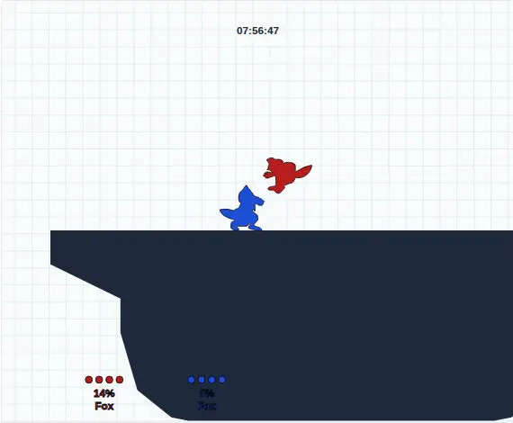
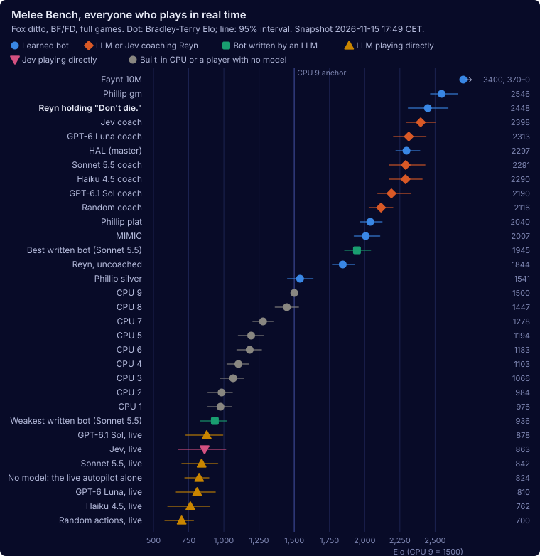
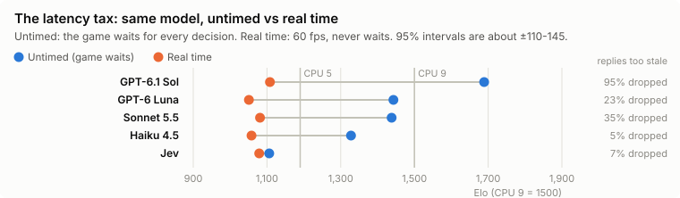
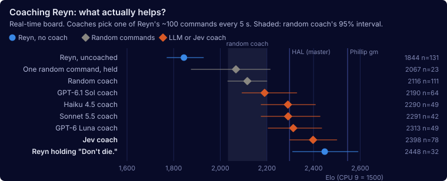

<!-- Source: writeup/melee-bench.template.md. Numbers and figures come from writeup/make_figures.py; edit prose here, then re-run it. -->

> **TL;DR.** I put frontier LLMs inside Super Smash Bros. Melee in five different ways, and rated all of them on one Elo scale next to Melee's own CPUs and the best published AI bots. LLMs pressing the buttons in real time play like a level 4 CPU. Given unlimited time to think, the best one beats the hardest CPU. Bots that LLMs wrote in 30 minutes land at that same level. The surprise came from coaching: four frontier LLMs took turns coaching a small neural bot, and the bot did best of all with no coach, just the words "Don't die." on repeat.

Most game benchmarks for LLMs are turn-based: chess, Pokémon, [Slay the Spire](https://arxiv.org/abs/2610.12596). The model can take as long as it likes and the game waits. I wanted the opposite: a real game at 60 frames per second that waits for nobody, where one second of thinking is 60 frames in which you can get hit, grabbed and thrown off the stage.

Melee is the obvious candidate. It came out in 2001, people still play it competitively, and its community has built absurdly good open tooling: [Slippi](https://slippi.gg) for online play and replays, [libmelee](https://github.com/vladfi1/libmelee) to read the game and press buttons from Python, and a line of AI bots going back to [Phillip](https://arxiv.org/abs/1702.06230), which beat professional players in 2017. I couldn't find anyone benchmarking LLMs on it, so over two days I built a benchmark, a website to watch it, an AI commentary booth, and a bot of my own.

---

## Melee in 30 seconds

Two characters fight on a small floating stage. Every hit raises the other player's damage percentage, and the higher it is, the further they fly. Knock them off the screen and they lose a life (a "stock"). Four stocks each, eight minutes, last one standing wins. It sounds simple, but at a high level it is about reactions measured in single frames and reading what your opponent will do next.



*14 seconds of a bench game, redrawn from the replay file: Faynt (blue) takes a stock off Phillip (red), both playing Fox.*

Every game in this post is Fox against Fox, a staple of top-level play, on two standard tournament stages.

---

## How it works

Everything runs on my home server: the real game, from my own disc, in the Slippi version of the Dolphin emulator. A Python library reads the game state every frame and drives a virtual controller. A dozen games can run side by side.

The opponents and yardsticks:

- **Melee's built-in CPUs**, levels 1 to 9.
- **Three small scripted bots** (one runs in, one shoots lasers, one spams Fox's "shine" move).
- **Five learned bots**, neural networks trained on human replays, all published with weights:
  [Phillip](https://github.com/vladfi1/slippi-ai) (vladfi1, in skill tiers from silver to gm, with a human-like reaction delay built in),
  [HAL](https://github.com/ericyuegu/hal) (Eric Gu),
  [MIMIC](https://github.com/erickfm/MIMIC) (erickfm),
  [Faynt](https://github.com/Na00s/Faynt-Tournament) (Frisson Labs) and
  [Reyn](https://huggingface.co/frisson-labs/Reyn-26C), from the same lab as Faynt: a small bot that takes **orders in plain English**, like "be more aggressive" or "edgeguard from the stage", about 100 of them for Fox.

LLMs are far too slow to press buttons every frame (a frame is 16.7 ms; a reply takes 1-3 seconds), so every setup gives the LLM a higher-level job and lets something faster handle the frames:

1. **The LLM plays, untimed.** It reads a short text description of the game and picks a move (`laser`, `shine`, `wavedash`, `recover`, `grab then up-throw`...), which my code turns into button presses. The game pauses while it thinks, so this only measures how good its choices are.
2. **The LLM plays, live.** The same, at full speed. While the model thinks, the character keeps doing the last move or a safe default, and a few reflexes never wait for the model. A reply older than 2 seconds is thrown away.
3. **Jev plays.** [Jev](https://typesafe.ai/blog/introducing-system-one-models-and-jev) is TypeSafe's fast decision model: it answers multiple-choice questions in about 0.15 seconds instead of 1-3, but it can't write text.
4. **The LLM coaches Reyn.** Reyn plays every frame, and every 5 seconds the coach looks at the game and picks one of Reyn's English commands.
5. **The LLM writes a bot.** A coding agent gets 30 minutes, a sandbox, the docs and a practice tool, and has to write a Python bot that then plays like any other entrant.

Here is what the model sees, about 150 words per moment:

```
f1370 time 7:38
YOU FALCO 58% 4stk | pos (-36,38) vel (+0.0,-2.0) face L air | nair f19 [ACTIVE] | jumps 1, busy | 33 from edge
OPP SAMUS 60% 4stk | pos (-25,0) vel (+0.9,+0.0) face R ground | walk_fast f15 | jumps 2, actionable | 44 from edge
REL opp is right+below: dx +11 dy -38 dist 40; you face AWAY from opp; opp faces away from you
EVENTS you hit opp 10x +27%
RECENT DECISIONS:
f1230 laser(short,1) → laser: fired 1, landed
```

The models were Claude Haiku 4.5, Claude Sonnet 5.5, GPT-6 Luna and GPT-6.1 Sol, with reasoning turned off (with it on, Haiku spent its whole budget thinking and never answered).

### One scale for everyone

Every entrant plays the same game: Fox vs Fox, Battlefield or Final Destination, 4 stocks, 8 minutes. All the results go into one Elo fit, the rating system from chess: 400 points of difference means the stronger side wins about 10 games out of 11. The hardest CPU, level 9, is pinned at **1500**, and every rating comes with a 95% interval.

There are two boards, because "LLM plays" means two things: a **real-time** board where the game never waits, and an **untimed** board where it waits for every decision. CPUs and bots play the same either way, so they appear on both and tie the two scales together.

Nobody picked the games by hand. A scheduler chooses the next game every few seconds, favouring games that would tighten the widest intervals for the fewest tokens. Cheap bot games get played a lot; expensive LLM games go where they teach the most. Overnight it played {{games_bench}} games in {{hours}} hours, and with older games that met the same rules and a follow-up study, the boards hold {{games_rt}} real-time and {{games_ut}} untimed games.

---

## What I found



From the top:

- **Faynt never lost**: {{rec rt faynt}}, most of it against Phillip gm. With a perfect record the fit can only say "much better than everyone", so its {{elo rt faynt}} is really a floor. Then Phillip gm ({{elo rt phillip:gm}}) and HAL ({{elo rt hal:MASTER}}).
- **Reyn being coached** sits around HAL, whoever the coach is. And right near the top, **Reyn with no coach, holding "Don't die."** More on that below.
- **The bots LLMs wrote** cluster around the level 9 CPU.
- **CPU levels barely matter in a Fox mirror.** Level 9 is 1500 and level 8 {{elo rt cpu:8}}, but levels 1-7 sit between {{elo rt cpu:4}} and {{elo rt cpu:7}} in no useful order: level 1 ({{elo rt cpu:1}}) is above level 5 ({{elo rt cpu:5}}). The CPU Fox jumps off the stage by itself a lot, and that matters more than its level.
- **At the bottom: every LLM playing live**, {{live_min}} to {{live_max}}, about a level 4 CPU, together with live Jev.

### 1. In real time, speed beats smarts



Given time to think, the models spread out: GPT-6.1 Sol beats the level 9 CPU ({{elo ut llm_paused:gpt-6.1-sol}}), the other three land between {{paused_rest_min}} and {{paused_rest_max}}, and all of them beat Jev ({{elo ut jev_paused}}). Bigger models make better choices than the fast one.

Live, all of that disappears. Every model loses {{tax_min}} to {{tax_max}} points, and they end up level with each other and with Jev. Sol, the best thinker, is the clearest case: its replies take 2-3 seconds, so **{{drop llm_live:gpt-6.1-sol}}** of them arrive too late and get thrown away. Live Sol is basically my default behaviour with an LLM occasionally getting a word in, and it still rates as high as any other live LLM ({{elo rt llm_live:gpt-6.1-sol}}). At this speed, the LLMs add nothing measurable over the simple autopilot they're wrapped in. Even Haiku, fast enough that only {{drop llm_live:claude-haiku-4-5-20251001}} of its replies are dropped, acts on a game state about 70 frames old, and in Melee that's several exchanges ago.

[LLM Colosseum](https://github.com/OpenGenerativeAI/llm-colosseum) found the same thing in Street Fighter (GPT-3.5 beat GPT-4 by being faster); this puts it on a scale with error bars.

### 2. The best coach is two words



Reyn with no orders rates {{elo rt reyn}}. With any coach it jumps by about 300 points, to HAL's level. But the obvious control, a "coach" that picks a random command every 5 seconds without looking at the game, gets most of that jump ({{elo rt coach:random}}). The four LLM coaches land {{coach_delta_min}} to {{coach_delta_max}} above random, and each of their intervals overlaps the random coach's. Only Jev is clearly better ({{elo rt coach_jev}}).

So I dug in, with about 25 extra games per variant:

- **Reyn mostly needs *any* command.** One random command held for the whole game already gets it to {{elo rt coach:random,fixed}}. Changing it every 5 seconds adds little on top.
- **Holding "Don't die." all game, with no coach at all, rates {{elo rt reyn:stock_protection}}**: level with the Jev coach, above every LLM coach, and about 330 above the random one.
- **Jev wins by accident.** Its favourite pick is "kill now", and Reyn's language layer maps that, every single time, to "Don't die." Counting that, Jev holds "Don't die." 41% of the time. The LLMs pick sensible-sounding plans (edgeguard, play aggressively) that turn out to be worth less.
- How often the coach speaks (every 1, 5 or 15 seconds) and giving it extra computed features made no measurable difference.

The lesson is less about LLMs than about the bot: the instruction that matters most is the boring one, and a language interface can quietly turn your coach's words into something else.

### 3. An LLM can write a level 9 CPU in 30 minutes


One 30-minute coding session per model, so **one run each**:

- **Sonnet 5.5** wrote a compact 135-line bot that shines, grabs shielding opponents and shoots lasers from afar: {{elo rt written:sonnet-5.5/run1}}, just above the level 9 CPU. It declared itself done after 21 minutes and ignored about 25 "keep improving" nudges.
- **Haiku 4.5** wrote the simplest bot, 108 lines that mostly call a built-in shine combo: {{elo rt written:haiku-4.5/run1}}, and the only written bot to take a game off a learned bot.
- **Opus 5.5** wrote the most engineered one, 303 lines with a move queue, frame-data-based defence and combos: {{elo rt written:opus-5.5/run1}}, the weakest of the three.
- An earlier **Sonnet** pilot held a button instead of tapping it, so its main move rarely came out, and it fell off the bottom twice a game: {{elo rt written:sonnet/pilot1}}, the lowest rating on the board.

Two runs of the same model differ far more than different models do. A few lines of input timing decide everything, so this ranks nothing yet.

### 4. Screenshots don't help

Given a screenshot instead of (or with) the text description, Haiku did worse: against a level 5 CPU, text only went {{perc_text}}, screenshot only {{perc_image}}, both {{perc_both}} ({{perc_text_n}} games each). On images alone it mostly didn't notice it was hanging off the ledge. In a test on 100 frames, every model read the damage numbers almost perfectly but got left/right and facing at about chance.

---

## What else I built

### A website to watch it all

The [website](https://melee.m19182.dev) shows the boards with a page per entrant (record, recent games, sample decisions), every game running on the server drawn live in 2D, a launcher to set up any matchup, every replay with the AI's decisions on a timeline, and these docs. The **Live** page streams the real game with a broadcast-style score bar and a feed of what each AI is thinking, timed to the video.

### An AI commentary booth

The Live page has two AI casters: Charlie on play-by-play ("loud, fast, loses his mind on big moments") and Laura on colour ("quick, dry wit, teases Charlie"). A fast LLM watches the game's events (combos, stocks lost, zero-to-deaths, self-destructs) and writes a line or two every few seconds, and ElevenLabs voices them. To keep costs down, voices are only made while someone is listening. A real exchange from a Faynt vs HAL game:

> **Charlie:** HAL MASTER's Fox is in the air and Faynt's Marth is waiting for him!
> **Laura:** Waiting is the right word. Faynt doesn't chase, Charlie, he collects.

### Our own bot: MeleeBot

On the last day I trained a bot of my own: a 5.4M-parameter transformer that copies human play, trained on 23,000 ranked online Yoshi games. It reads the last 4 seconds of the game and predicts the next controller input, in 2 ms per frame. Its first game, against the level 9 CPU, ended 0-3: it took one stock and lost all four of its own by falling below the stage. A bigger version is training now.

### A simulator

Melee's community has decompiled the game's code back into C, and [melee-sim-light](https://github.com/kyhavlov/melee-sim-light) runs it without an emulator. I hooked all our players into it, including the learned bots, and checked it against real games: 287 of 300 replays matched frame for frame (the other 13 were unfinished files), and the game itself runs about 100 times faster than in the emulator. Its catch: there are no built-in CPUs.

### Playing the bots yourself

You can play the bots yourself, on a laptop with a controller (Phillip at any skill tier, Faynt or Reyn with a command of your choice) or from home over Slippi's online direct connect. The board has a slot waiting for human results. Come try.

---

## What it cost

The Claude and GPT tokens went through my subscriptions, so the real bill is the subscriptions. The main bench used {{tokens_m}}M tokens: {{tokens_claude_m}}M on Claude and {{tokens_gpt_m}}M on GPT. At list prices the Claude part alone would be about ${{usd_claude}}. Jev is billed separately and cost ${{usd_jev}} in total. The bots LLMs wrote cost under $2 each to write.

Per game:

{{table_tokens}}

"Tokens" counts every call, including the live replies that arrived too late and were thrown away. A coach is called every 5 seconds instead of every half second, so it costs 5-10 times less than a player and plays far better.

---

## Caveats

- **One matchup.** Fox vs Fox on two stages. Other characters could change everything, and the CPU results in particular are a quirk of Fox.
- **The intervals are real.** Neighbours on the board usually overlap. The big gaps (learned bots vs everything, live vs untimed, coached vs uncoached Reyn, "Don't die.") are well outside the noise; most orderings inside a group are not.
- **The harness is part of the result.** The moves, reflexes, prompt and 2-second cutoff are mine. A better harness would score higher; the live LLMs are partly a measure of my autopilot.
- **Model names can change underneath.** Models were called through subscriptions, and providers can change what's behind a name.

---

## What's next

- **A faster brain**: a small local model on my GPU at about half a second per decision, since speed is what matters live.
- **A better coach**: start from "Don't die." and only switch with a good reason.
- **MeleeBot, bigger**: the 20M version, then onto the board.
- **Bot-writer round 2**: three runs per model, so it can actually rank something.
- **Me**: the board has a slot for a human. I'm not expecting a good number.

---

Built on [Slippi](https://slippi.gg), [libmelee](https://github.com/vladfi1/libmelee), [Slippi Lab](https://github.com/frankborden/slippilab) and [melee-sim-light](https://github.com/kyhavlov/melee-sim-light), with the bots of vladfi1 (Phillip), Eric Gu (HAL), erickfm (MIMIC) and Frisson Labs (Faynt, Reyn), [TypeSafe's Jev](https://typesafe.ai/blog/introducing-system-one-models-and-jev) and [ElevenLabs](https://elevenlabs.io) voices. Related work I leaned on: [StarSkirmish](https://starskirmish.com/bench/v0-1/), [SpireBench](https://arxiv.org/abs/2610.12596), [VideoGameBench](https://arxiv.org/abs/2505.18134) and [Qwen plays Smash](https://hgali.sh/reflex). Technical details for every part are in the [docs](https://melee.m19182.dev/docs/status).
